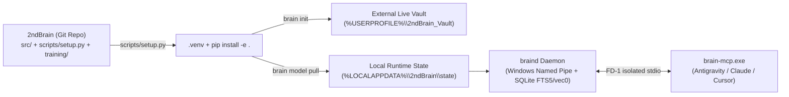
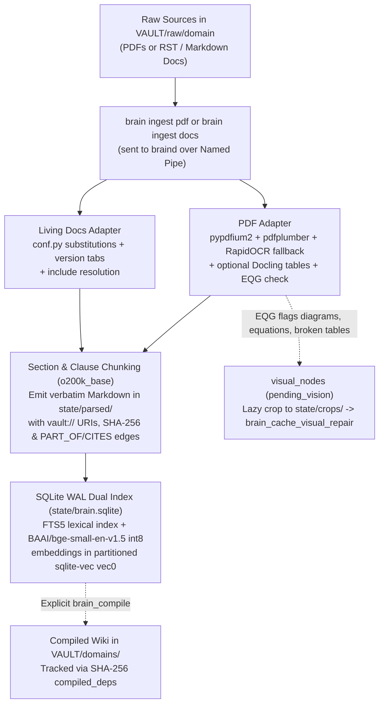
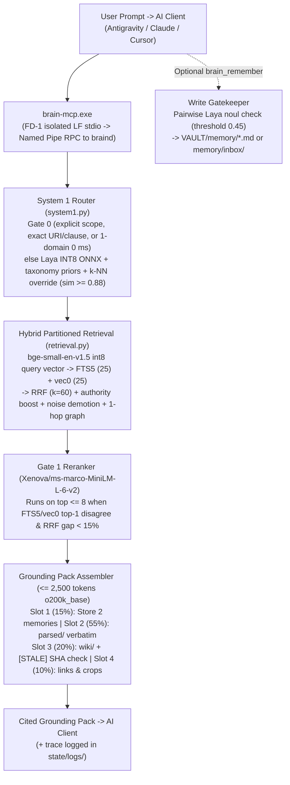

# 2ndBrain v2

Local, offline-first engineering knowledge base, persistent memory ledger, and CPU System 1 router for Windows (Python 3.13+).

> **Upgrading from v1?** The previous v1 monorepo is archived at tag [`v1-archive`](../../tree/v1-archive). v2 separates the public engine repository from your external Obsidian Vault and local SQLite/ONNX runtime state so raw source documents and personal memories never enter Git.

## Architecture (Zero-Leak Vault Isolation)



- **Engine Repo (`2ndBrain/`):** Contains source code, `scripts/setup.py`, generic starter templates (`src/second_brain/templates/vault/`), and Laya fine-tuning scripts (`training/`).
- **External Vault (`%USERPROFILE%\2ndBrain_Vault`):** Holds your raw PDFs/docs (`raw/`), `specialists/*.yaml`, `memory/*.md`, `ontology/taxonomy.yaml`, and compiled `domains/` outside the engine repo.
- **Local State (`%LOCALAPPDATA%\2ndBrain\state`):** Holds `brain.sqlite`, parsed text chunks, visual crops, logs, and ONNX models (`laya_stock`, FastEmbed embedder/reranker). Never committed to Git.

---

## Data & Execution Flows

### 1. Raw Source Materials to Ingested Knowledge



1. **Stage source files:** Place source PDFs or RST/Markdown directories under `<VAULT>\raw\<domain>\`.
2. **Parse and quality-gate:** `brain ingest pdf` extracts text via `pypdfium2` and `pdfplumber`, runs `rapidocr-onnxruntime` on image-only pages, optionally parses tables with `docling`, and passes each page through the Extraction Quality Gate (`EQG`) to flag visual crops as `pending_vision`. `brain ingest docs` resolves Sphinx `conf.py` variables, version tabs, and file includes.
3. **Chunk and link:** The engine splits sections under `o200k_base` token bounds, writes verbatim Markdown files into `state/parsed/<source>_<ver>/`, assigns `vault://<source>@<ver>#<clause>` URIs with LF SHA-256 hashes, and inserts `PART_OF` and `CITES` edges.
4. **Dual-index in SQLite:** `braind` commits chunks to `state/brain.sqlite` (`FTS5` for exact lexical matching) and embeds them with `BAAI/bge-small-en-v1.5` (`int8`) into domain/version-partitioned `sqlite-vec` (`vec0`) tables.
5. **Synthesize or repair on demand:** `brain_compile` writes summary pages into `<VAULT>\domains\` linked to upstream `parsed/` SHA-256 hashes, and `brain_cache_visual_repair` indexes host transcriptions of cropped figures into `parsed/`.

### 2. Prompt to Output



1. **MCP transport:** The AI client invokes `brain_query` (or `brain_route`, `brain_grep`, `brain_get_clause`) through `brain-mcp.exe`, which isolates file descriptors 0 and 1 and forwards RPC requests to `braind` over a user-scoped Windows Named Pipe.
2. **System 1 domain routing:** Gate 0 handles explicit `domain_scope`, exact `vault://` or clause IDs, or single-specialist vaults (`gate0_single_domain`, `0 ms`). With 2+ specialists, Laya INT8 ONNX scores domains, applies `ontology/taxonomy.yaml` alias priors when un-finetuned, and checks certified `exemplars` (`k-NN` similarity `>= 0.88`).
3. **Hybrid retrieval and graph expansion:** `braind` embeds the prompt once, fetches up to 25 `FTS5` and 25 `vec0` matches inside the routed partitions, fuses rankings via RRF (`k=60`) with authority-tier weights and TOC/index noise demotion, and expands 1-hop `EXTRACTED` and certified `INFERRED_RELATED` neighbors.
4. **Confidence-gated reranking and packing:** If `FTS5` and `vec0` top-1 URIs disagree and the normalized RRF gap is below `15%`, `Xenova/ms-marco-MiniLM-L-6-v2` reranks up to 8 candidates. `packer.py` fills a `2,500`-token Grounding Pack across four quotas: active Store 2 memories (`15%`), verbatim `parsed/` clauses (`55%`), `wiki/` syntheses checked for `[STALE]` SHA-256 drift (`20%`), and 1-hop linked references plus lazy `VISUAL_CROP_REQUIRED` crop paths (`10%`).
5. **Grounded answer and memory loop:** The AI client answers from the returned `vault://` citations and `memory://` records. Explicit `brain_remember` calls run pairwise Laya `noul` conflict detection (`>= 0.45`) before writing active entries to `<VAULT>\memory\*.md` or staging to `memory/inbox/` for `brain certify`.

---

## Requirements

- **OS:** Windows 10/11 (`win32` Named Pipe IPC + Windows ACLs)
- **Python:** Python 3.13+ (full installer from python.org, not the Microsoft Store stub)
- **Disk:** ~700 MB free for stock ONNX models (`laya_stock`, `BAAI/bge-small-en-v1.5`, `Xenova/ms-marco-MiniLM-L-6-v2`)

---

## Quickstart (Auto-Detect Setup)

1. Clone the repository:
   ```powershell
   git clone https://github.com/Fabbbbbbb99/2ndBrain.git
   cd 2ndBrain
   ```
2. Run the auto-detect installer (creates `.venv`, installs dependencies, initializes an external Vault at `%USERPROFILE%\2ndBrain_Vault`, writes `%LOCALAPPDATA%\2ndBrain\config.toml`, pulls & SHA-256-verifies stock models, configures Git leak-guard hooks, generates ready-to-paste MCP snippets in `configs/generated/`, and runs `brain doctor --stdio-check`):
   ```powershell
   py -3.13 scripts/setup.py
   ```
   Or via PowerShell wrapper:
   ```powershell
   powershell -ExecutionPolicy Bypass -File .\setup.ps1
   ```
3. *(Optional)* Auto-register Antigravity MCP & export starter skills (creates a timestamped backup of `~/.gemini/config/mcp_config.json` before merging `second-brain` and runs `brain export-skills --no-prune`):
   ```powershell
   py -3.13 scripts/setup.py --register-mcp
   ```

### Useful Setup Flags
- `--vault <PATH>` / `--state <PATH>` / `--config <PATH>`: Override default locations.
- `--skip-models`: Skip model downloads during setup (run `.venv\Scripts\brain.exe model pull` later before querying).
- `--skip-fastembed`: Download `laya_stock` only (`~506 MB`) and let FastEmbed download on first use (`~157 MB`).
- `--allow-onedrive`: Allow OneDrive-synced Vault/state paths (disabled by default due to file-locking risks).
- `--force`: Overwrite an existing `config.toml` that points to a different Vault.

---

## Connecting AI Clients

By default, `scripts/setup.py` writes ready-to-paste JSON configs with your detected paths under `configs/generated/` (gitignored):
- `configs/generated/antigravity.local.json`
- `configs/generated/claude_desktop.local.json`
- `configs/generated/cursor.local.json`

For Claude Desktop or Cursor custom instructions, see [configs/AGENT_INSTRUCTIONS.example.md](configs/AGENT_INSTRUCTIONS.example.md).

---

## Using Your 2ndBrain

### 1. Define a Domain Specialist
Rename or duplicate `specialists/example_domain.yaml` inside your external Vault (`%USERPROFILE%\2ndBrain_Vault\specialists\<your_domain>.yaml`) and register matching domain aliases in `ontology/taxonomy.yaml`, then sync the manifest hash:
```powershell
.venv\Scripts\brain.exe init --sync-manifest
```

### 2. Ingest Documents
Place raw documents inside `<VAULT>\raw\<your_domain>\` and ingest them into SQLite:
```powershell
.venv\Scripts\brain.exe ingest pdf "<VAULT>\raw\<domain>\<file>.pdf" --domain <domain> --source-id <SOURCE_ID> --version <VER>
.venv\Scripts\brain.exe ingest docs "<VAULT>\raw\<domain>\docs" --domain <domain> --source-id <SOURCE_ID> --version <VER>
```

### 3. Manage Daemon, Skills & Memory
```powershell
.venv\Scripts\brain.exe doctor --stdio-check
.venv\Scripts\brain.exe daemon start
.venv\Scripts\brain.exe query "your technical question"
.venv\Scripts\brain.exe certify
.venv\Scripts\brain.exe export-skills
.venv\Scripts\brain.exe graph-export --open
```

---

## Optional: Purpose-Training Laya (Multi-Domain Routing)

With 1 specialist, System 1 short-circuits routing at `0 ms`. Once you have 2+ specialists, stock zero-shot Laya routes across them automatically, or you can fine-tune a custom INT8 ONNX checkpoint on Kaggle/Colab:

1. Build JSONL splits (`train.jsonl`, `val.jsonl`, `calibration.jsonl`):
   ```powershell
   .venv\Scripts\python.exe training/build_dataset.py --out-dir data/laya_splits
   ```
2. Fine-tune using [training/laya_finetune_kaggle.ipynb](training/laya_finetune_kaggle.ipynb) and export via `training/export_int8_onnx.py`.
3. Swap the signed checkpoint in locally:
   ```powershell
   .venv\Scripts\brain.exe model swap --model-dir "<PATH_TO_EXPORTED_BUNDLE>"
   ```

---

## License

[MIT](LICENSE)
