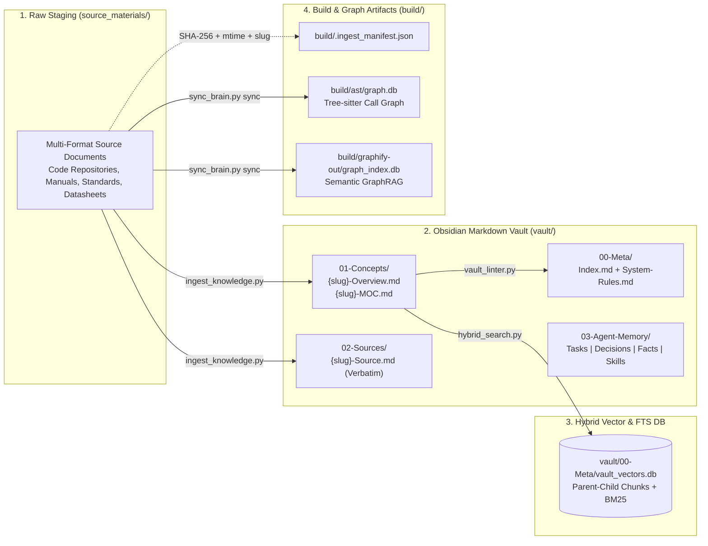
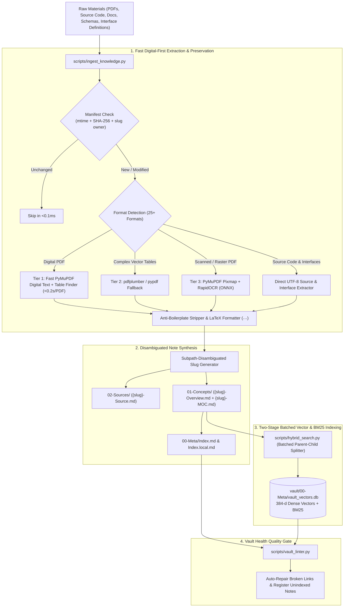
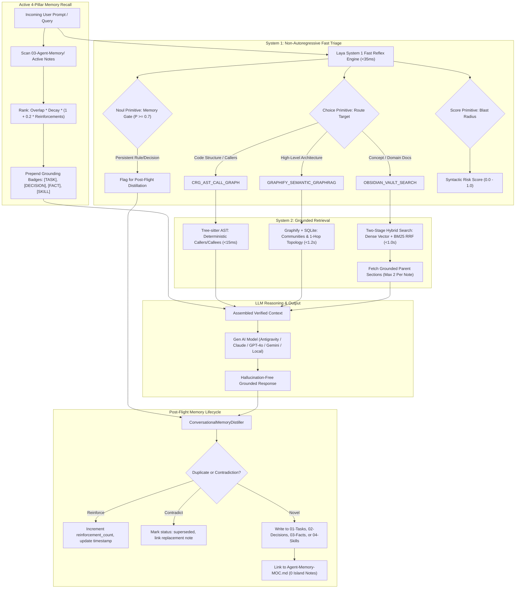

# 🧠 2ndBrain: Dynamic Local-First Second Brain for LLMs

A local-first, dual-process cognitive second brain that turns multi-format source materials, technical codebases, and live conversation turns into a persistent, queryable knowledge engine.

- **System 1 Reflex Engine (`models/laya-knowledge-base`)**: Neural triage engine powered by **ModernBERT-large (421M)**. Evaluates typed decision schemas (`Choice`, `Score`, `Noul`) in a single parallel forward pass in **~35ms** with zero token generation cost. Optimized with **Focal Loss ($\gamma=2.0$)**, **Vector Temperature Calibration**, and **Isotonic Regression**, accompanied by a `<0.1ms` calibrated heuristic fallback.
- **Structural Code Intelligence (`build/ast/`)**: Tree-sitter AST parser and SQLite engine for deterministic call graphs, callers/callees, import hierarchies, and syntactic blast-radius calculation without model hallucination.
- **Semantic GraphRAG (`build/graphify-out/`)**: High-level knowledge graph with community detection (Leiden/Louvain algorithms), bridge nodes, and cross-document concept clustering backed by a fast indexed SQLite database (`graph_index.db`).
- **Markdown Knowledge Vault (`vault/`)**: Local knowledge vault interconnected via bidirectional `[[wikilinks]]`, domain Maps of Content (`-MOC.md`), structured summaries (`-Overview.md`), verbatim source extracts (`-Source.md`), and Architectural Decision Records (ADRs).
- **Two-Stage Hybrid Search (`vault/00-Meta/vault_vectors.db`)**: Offline 384-d dense vector embeddings (`fastembed` with `BAAI/bge-small-en-v1.5`) fused with BM25 keyword/stem matching via Reciprocal Rank Fusion (RRF) in local SQLite. Two-stage coarse-to-fine candidate selection retrieves grounded parent context in `<1.0s`.
- **4-Pillar Persistent Memory (`vault/03-Agent-Memory/`)**: Categorizes long-term context into `01-Tasks`, `02-Decisions`, `03-Facts`, and `04-Skills` with schema validation, conflict deduplication, decay-weighted prompt recall, and bidirectional Map of Content navigation.

---

## 🔬 Dual-Process Cognitive Architecture

Standard LLMs suffer from three fundamental limitations:
1. **Context Amnesia**: Models forget past instructions, architectural decisions, and user preferences once a conversation turn or session ends.
2. **Structural Hallucination**: When analyzing complex codebases, models guess call graphs and fail to predict breaking changes accurately.
3. **Token Inefficiency**: Ingesting thousands of lines of documentation or code into context windows is slow, expensive, and dilutes attention.

`2ndBrain` solves these limitations with a **Dual-Process Cognitive Architecture**:
- **System 1 (Fast Reflex Engine, ~33–45ms)**: Runs locally. Query routing, document novelty gating, blast-radius risk scoring, and memory distillation happen before calling expensive LLMs.
- **System 2 (Deep Reasoning & Multi-Engine Grounding)**: Combines compiler-grade AST code intelligence, semantic GraphRAG, two-stage vector/keyword search, and a persistent Markdown knowledge vault.

---

## 🧱 The 6 Architectural Layers

| Layer | Engine | Implementation & Storage | Primary Responsibility |
| :--- | :--- | :--- | :--- |
| **L0: Fast Reflex** | **Laya** | `models/laya-knowledge-base` (ModernBERT-large, 421M) | Evaluates typed queries in a single forward pass without token generation. Routes queries, scores blast risk, gates novelty, and filters conversational memories. Includes a `<0.1ms` heuristic fallback. |
| **L1: Code Structure** | **Code-Review-Graph** | `build/ast/` (Tree-sitter AST + SQLite) | Deterministic function call trees, callers/callees, import hierarchies, and syntactic blast radius without model hallucination. Disambiguates overloaded functions in `<15ms`. |
| **L2: Semantic Graph** | **Graphify** | `build/graphify-out/` (Leiden / Louvain GraphRAG + `graph_index.db`) | Module boundaries, concept clustering, bridge nodes, and cross-document relational graphs queryable in `<1.2s`. |
| **L3: Knowledge Vault** | **Obsidian** | `vault/` (Markdown + bidirectional `[[wikilinks]]`) | Human-navigable concept notes (`01-Concepts/`), verbatim extracts (`02-Sources/`), master index (`00-Meta/Index.md`), and learned constraints (`03-Agent-Memory/`). |
| **L4: Vector Index** | **Hybrid Search** | `vault/00-Meta/vault_vectors.db` (`fastembed` BGE + SQLite BM25) | Two-stage coarse-to-fine Parent-Child retrieval fusing dense cosine similarity with BM25 token/stem rankings via Reciprocal Rank Fusion (RRF) in `<1.0s`. |
| **L5: Persistent Memory** | **4-Pillar Memory Ontology** | `vault/03-Agent-Memory/` (Markdown + YAML Schema Validation) | Categorizes long-term context into `01-Tasks`, `02-Decisions`, `03-Facts`, and `04-Skills` with bidirectional `Agent-Memory-MOC.md` linking, confidence scoring, conflict deduplication, and decay-weighted prompt recall. |

---

## 🗄️ How Knowledge is Stored

Knowledge is organized across **4 storage tiers**:



### 1. Raw Staging (`source_materials/`)
Staged source files are grouped by domain or project directories configured in `configs/sources.local.yaml`:
- Source code repositories (C, C++, Python, JavaScript, TypeScript, Shell, Lua, Julia, MATLAB, Rust, Go).
- Technical documentation, reference manuals, and API specifications.
- Standards, specifications, and regulatory guidelines.
- Academic papers, university lecture notes, and textbook chapters.
- Configuration schemas, interface definitions, and hardware datasheets.

### 2. Obsidian Markdown Vault (`vault/`)
Every ingested document generates **3 linked Markdown notes** organized hierarchically, with nested subpaths and MD5 disambiguation preventing collisions:
- **`01-Concepts/.../{slug}-Overview.md`**: Executive takeaways, high-level summary, document metadata scope, Mermaid architecture diagrams, and normative equations/tables.
- **`01-Concepts/.../{slug}-MOC.md`**: Map of Content navigation hub linking `{slug}-Overview`, `{slug}-Source`, and `00-Meta/Index`.
- **`02-Sources/.../{slug}-Source.md`**: Complete verbatim text, clean tables, and code extractions from the source file.

### 3. Incremental Build Manifest (`build/.ingest_manifest.json`)
Stores `{mtime, size, sha256, slug}` for every ingested source file and tracks slug ownership so incremental builds skip unchanged files in `<0.1ms` and flush manifest updates in batches.

---

## 🔄 Lifecycle Flows: How 2ndBrain Works

### Flow 1: Building & Updating the Knowledge Base



#### Common Build Commands:
```powershell
# 1. Incremental build (processes only new/modified/missing files from configs/sources.local.yaml)
python -u scripts/build_knowledge_base.py

# 2. Fast incremental document ingestion only (skip vector indexing and linting)
python -u scripts/build_knowledge_base.py --skip-index --skip-lint

# 3. Full clean-slate rebuild (re-extracts all files regardless of manifest cache)
python -u scripts/build_knowledge_base.py --force

# 4. Run Vault Linter & auto-register any unindexed notes into 00-Meta/Index.md
python -u scripts/sync_brain.py lint --fix
```

---

### Flow 2: When a User Prompts



---

## 🏛️ 4-Pillar Agent Memory Ontology

Long-term conversational memory is structured into four specialized pillars materialized as local Markdown files inside `vault/03-Agent-Memory/`:

```text
vault/03-Agent-Memory/
├── 01-Tasks/                   # Operational backlogs & milestones (status, priority, due_date)
├── 02-Decisions/               # Architectural Decision Records (ADRs) (rationale, alternatives)
├── 03-Facts/                   # Grounded invariant truths & system specs (confidence: 1.0)
├── 04-Skills/                  # Reusable execution procedures & recipes (trigger, steps)
├── Archive/                    # Archived / superseded historical notes
├── Consolidation-Reports/      # Sleep-cycle consolidation audit logs
├── Sessions/                   # Logged engineering session summaries
├── Agent-Memory-MOC.md         # Bidirectional Map of Content (0 island notes)
└── telemetry.jsonl             # Passive System 1 routing & latency telemetry
```

| Pillar | Storage Directory | Frontmatter Metadata Schema | Purpose & Examples |
| :--- | :--- | :--- | :--- |
| **📋 Tasks** | `03-Agent-Memory/01-Tasks/` | `type: task`, `status: pending\|in_progress\|completed`, `priority: high\|medium\|low`, `milestone: "..."` | Actionable work items, roadmap milestones, and execution checklists. |
| **⚖️ Decisions** | `03-Agent-Memory/02-Decisions/` | `type: decision`, `status: active\|superseded`, `confidence: 0.95`, `tags: [adr, memory/decision]` | Architectural choices, evaluated alternatives, and trade-offs. |
| **📌 Facts** | `03-Agent-Memory/03-Facts/` | `type: fact`, `status: active`, `domain: "..."`, `confidence: 1.0` | Invariant truths, system specifications, hardware parameters, and network constraints. |
| **🛠️ Skills** | `03-Agent-Memory/04-Skills/` | `type: skill`, `status: active`, `trigger: "condition"`, `tags: [memory/skill]` | Step-by-step procedural execution patterns, debugging workflows, and setup recipes. |

---

## 🔌 Cross-Desktop Bootstrap & Setup Across Gen AI Environments

### 0. One-Command Cross-Desktop Bootstrap (Any OS)
After cloning the repository on any desktop (`Windows`, `macOS`, or `Linux`), run the cross-desktop bootstrapper:

```powershell
git clone https://github.com/Fabbbbbbb99/2ndBrain.git
cd 2ndBrain
pip install -r requirements.txt
python scripts/bootstrap.py
```

`bootstrap.py` automatically:
1. Creates all required `vault/`, `build/`, and `source_materials/` directory scaffolding.
2. Initializes `configs/sources.local.yaml` and `vault/00-Meta/Index.local.md`.
3. Reconciles `vault/03-Agent-Memory/Agent-Memory-MOC.md` against local 4-Pillar notes and installs Git pre-commit hooks.
4. Renders and installs the **`2ndBrain`** skill into `~/.gemini/config/skills/` with your machine's exact repository path.
5. Generates machine-local MCP configuration files (`configs/claude_desktop_config.local.json` and `configs/cursor_mcp.local.json`).
6. Verifies `models/laya-knowledge-base/model.safetensors`; if absent on a fresh clone, automatically generates the synthetic dataset and trains the calibrated ModernBERT-large System 1 router on your GPU/MPS/CPU (pass `--skip-laya` to use the `<0.1ms` heuristic engine without training).

---

### 1. Google Antigravity
`python scripts/bootstrap.py` automatically renders and installs `SKILL.md` (`2ndBrain`) into `~/.gemini/config/skills/`.

---

### 2. Claude Desktop & Claude Code (Anthropic)
`2ndBrain` exposes a FastMCP server (`scripts/mcp_server.py`) providing native brain tools:
- `brain_query(question)`: Intelligent routed query combining System 1 reflex, AST code search, GraphRAG, and Hybrid search with active memory recall.
- `brain_blast_radius(symbol)`: Tree-sitter AST blast radius and callers calculation.
- `brain_recall(topic)`: Targeted recall of active 4-Pillar rules and constraints.
- `brain_remember(rule_or_decision, category)`: Crystallizes learned rules into `01-Tasks`, `02-Decisions`, `03-Facts`, or `04-Skills`.

1. Run `python scripts/bootstrap.py` to generate `configs/claude_desktop_config.local.json`.
2. Copy its `mcpServers.second-brain` block into your Claude configuration file:
   ```json
   {
     "mcpServers": {
       "second-brain": {
         "command": "python",
         "args": [
           "<PATH_TO_REPO>/scripts/mcp_server.py"
         ],
         "env": {
           "SECOND_BRAIN_VAULT": "<PATH_TO_REPO>/vault",
           "KNOWLEDGE_BASE_ROOT": "<PATH_TO_REPO>"
         }
       }
     }
   }
   ```

---

### 3. Cursor IDE & Windsurf
1. Open **Cursor Settings** -> **Features** -> **MCP Servers** (or copy `configs/cursor_mcp.local.json` generated by `bootstrap.py`).
2. Add command server `second-brain`:
   ```text
   python "<PATH_TO_REPO>/scripts/mcp_server.py"
   ```

---

### 4. Python SDK Integration (`scripts/llm_client.py`)
Use `UniversalBrainAdapter` to wrap API calls with automated pre-flight memory injection and post-flight distillation across OpenAI, Anthropic, Google Gemini (`google-genai`), or local Ollama endpoints:

```python
from scripts.llm_client import UniversalBrainAdapter
from google import genai

adapter = UniversalBrainAdapter()
client = genai.Client()

user_prompt = adapter.enrich_prompt("Validate our telemetry schema against project standards.")
response = client.models.generate_content(
    model="gemini-2.5-flash",
    contents=user_prompt
)
adapter.distill_turn(user_prompt, response.text or "")
```

---

## 🛠️ CLI Quick Reference Guide

The master orchestrator CLI is located at [`scripts/sync_brain.py`](scripts/sync_brain.py):

```powershell
# 1. Build / incrementally update the entire knowledge base from configs/sources.local.yaml
python -u scripts/build_knowledge_base.py

# 2. Ingest a single file or directory into the Obsidian vault
python -u scripts/sync_brain.py ingest --source "path/to/documents"

# 3. Synchronize all graph engines (AST + Graphify + fastembed Vectors + Obsidian)
python -u scripts/sync_brain.py sync --target "."

# 4. Intelligent query routed by Laya (System 1) with Hybrid Search & active memory recall
python -u scripts/sync_brain.py query "Explain the system architecture"

# 5. Compute AST blast radius and callers for a symbol or file
python -u scripts/sync_brain.py blast <function_or_class_name>
python -u scripts/sync_brain.py blast --file "path/to/module.py"

# 6. Explicitly crystallize a durable memory across pillars (--category: task, decision, fact, skill)
python -u scripts/sync_brain.py remember "Use gRPC for inter-service communication" --category decision --tag "architecture"

# 7. Archive a conversation dialogue or meeting into persistent memory
python -u scripts/sync_brain.py session --topic "Architecture Review" --summary "Decided on microservices interfaces." --decisions "Use protobuf v3"

# 8. Run Memory Consolidation ("Sleep Cycle") to prune, merge, and promote rules
python -u scripts/sync_brain.py consolidate

# 9. Distill durable rules and decisions from a chat transcript
python -u scripts/sync_brain.py distill --transcript "path/to/transcript.jsonl"

# 10. Audit vault health, broken wikilinks, and auto-register unindexed notes
python -u scripts/sync_brain.py lint --fix

# 11. Create & manage atomic GSD work-units (Max 45m timebox, binary DOD)
python -u scripts/gsd_task.py create "Implement Rate Limiter" --goal "Add Token Bucket middleware" --timebox 30m
```

---

## 📂 Repository Scaffolding

The repository only tracks clean engine code, configurations, skills, and initial vault scaffolding templates. All local models (`models/`), raw materials (`source_materials/`), compiled databases (`build/`), local tests (`tests/`), local vector DBs (`vault_vectors.db`), and ingested documents are excluded via `.gitignore`:

```text
2ndBrain/
├── SKILL.md                        # Master Antigravity skill definition
├── README.md                       # System architecture & deployment guide
├── requirements.txt                # Python environment dependencies
├── .gitignore                      # Git isolation configuration
├── configs/                        # Ingestion manifests & client configurations
│   ├── sources.example.yaml        # Source manifest template
│   ├── claude_desktop_config.json  # Claude Desktop / Claude Code MCP configuration template
│   ├── cursor_mcp.json             # Cursor IDE / Windsurf MCP configuration template
│   ├── CLAUDE.md                   # Agent guidelines for Claude Code
│   ├── .cursorrules                # System rules for Cursor IDE
│   ├── SYSTEM_PROMPT.md            # Generic grounding prompt for LLM chat UIs
│   └── skills/                     # Domain & specialized skill definitions
│       ├── robbie/
│       │   └── SKILL.md            # Specialized engineering skill template
│       └── marie/
│           └── SKILL.md            # Marine & subsea systems skill template
├── scripts/                        # Core orchestration, ingestion, search, and memory engines
│   ├── build_knowledge_base.py     # Master orchestrator builder
│   ├── ingest_knowledge.py         # Multi-format document & code ingester (25+ formats)
│   ├── hybrid_search.py            # Two-stage Parent-Child dense vector + BM25 RRF search
│   ├── sync_brain.py               # Master CLI entrypoint (sync, query, ingest, lint, blast, remember)
│   ├── laya_router.py              # System 1 reflex decision engine + heuristic fallback
│   ├── vault_linter.py             # Vault link integrity & markdown quality gate
│   ├── memory_distiller.py         # 4-Pillar conversational memory distiller
│   ├── mcp_server.py               # FastMCP server exposing native brain tools
│   ├── llm_client.py               # Universal LLM client adapter (OpenAI, Anthropic, Gemini, Ollama)
│   ├── gsd_task.py                 # Timebox & task lifecycle manager
│   ├── audit_accuracy.py           # Retrieval accuracy & fidelity audit tool
│   ├── generate_laya_dataset.py    # Synthetic routing dataset generator
│   ├── train_laya.py               # ModernBERT-large training & temperature calibration pipeline
│   ├── install_git_hooks.py        # Installs local Git pre-commit hooks
│   ├── pre_commit_hook.py          # Enforces Rule 5 Git isolation on staged files
│   └── bootstrap.py                # Cross-desktop setup tool (auto-configures local paths)
└── vault/                          # Clean Obsidian Markdown Vault Scaffolding
    ├── .obsidian/                  # Obsidian workspace configuration & graph layout
    │   ├── app.json
    │   ├── appearance.json
    │   ├── core-plugins.json
    │   └── graph.json
    ├── 00-Meta/                    # Vault indexes, guidelines, and templates
    │   ├── Index.md                # Master Map of Content index
    │   ├── System-Rules.md         # Persistent knowledge base invariants
    │   └── Templates/
    │       └── Template-GSD-Task.md
    ├── 01-Concepts/
    │   └── README.md               # Concept summaries directory scaffold
    ├── 02-Sources/
    │   └── README.md               # Primary extracts directory scaffold
    └── 03-Agent-Memory/            # 4-Pillar agent memory scaffolding
        ├── Agent-Memory-MOC.md     # Map of Content linking all memory notes
        ├── 01-Tasks/
        │   └── README.md
        ├── 02-Decisions/
        │   └── README.md
        ├── 03-Facts/
        │   └── README.md
        ├── 04-Skills/
        │   └── README.md
        └── Sessions/
            └── README.md
```

---

## 🛡️ Grounding & Integrity Principles
- **Zero Token Waste**: Fast reflex routing runs locally via Laya ModernBERT in `<45ms` without burning API tokens.
- **Fast Incremental Builds**: `build/.ingest_manifest.json` caches file `mtime`, `size`, `sha256`, and slug ownership so incremental updates skip unchanged files in `<0.1ms` and extract digital PDFs in `<0.2s` via PyMuPDF.
- **Zero Slug Collisions**: Nested directories and files are disambiguated by relative subpath and MD5 hash fallback.
- **No Hallucinated Edges**: Call hierarchies and blast radii are computed deterministically via Tree-sitter AST (`build/ast/`).
- **Human Transparency**: Every concept and learned memory is stored in human-editable Obsidian Markdown notes inside `vault/`.
